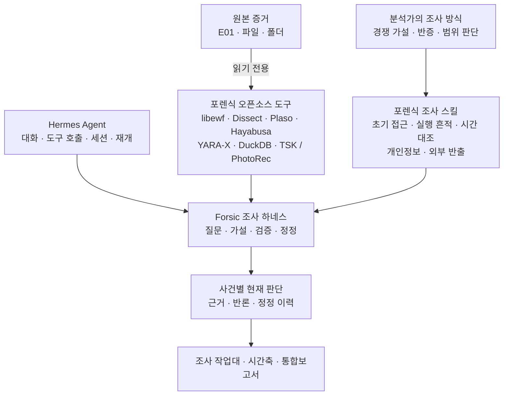
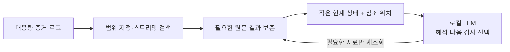

# Forsic · 포식이

현재 공개 기준 버전은 **0.1**입니다.

**디스크 이미지 기반 침해사고 조사를 위한 AI 에이전트 하네스**

Forsic은 [Hermes Agent](https://github.com/NousResearch/hermes-agent)의 범용 실행 기반에 **오픈소스 포렌식 도구, 전문 조사 스킬, 현업 분석가의 조사 방법론**을 결합한 로컬 우선 디지털 포렌식 작업대입니다.

첫 화면에서 조직별 테넌트를 선택합니다. 같은 테넌트의 사건들은 짧은 운영기억과 명시적으로 저장한 사례를
공유하며, 현재 사건의 원본 증거·판단과는 구분합니다. 운영기억은 기본적으로 요청할 때 저장하며,
`확인된 운영 지식 자동 저장`을 켜면 분석가가 명확하게 설명한 내용 중 재사용할 가치가 있는 사실을
포식이가 저장합니다. 실제 저장 결과와 출처·적용 범위·수정 이력은 관리 화면에서 확인하고
정정·제외·복원할 수 있습니다. 기존 사건과 재개 링크는 제자리에서 이관합니다.
자세한 범위와 한계는 [테넌트와 운영기억](docs/tenant-architecture.md)을 참고하세요.

이미징된 디스크와 파일을 읽고, 조사 질문에 맞는 단서를 찾고, 서로 다른 설명을 대조합니다. 이 과정의 근거와 정정 이력을 사건별로 보존해 중단된 조사를 이어가고, 최종 판단을 보고서로 정리합니다.

범용 에이전트가 *도구를 호출하고 작업을 이어가는 기반*이라면, Forsic은 그 위에 **증거를 어떻게 조사하고 어떤 수준까지 결론 내릴 것인지**에 관한 포렌식 전용 계층을 더합니다.

## 범용 하네스에 포렌식을 더하다



*도구는 실제 자료를 읽고, 스킬은 조사 방법을 안내하며, 모델은 다음 확인과 판단을 선택합니다. 도구의 지원 범위는 설치 구성과 증거 형식에 따라 달라집니다.*

## 주요 특징

### 1. 분석가의 사고방식을 따르는 조사

분석은 도구 목록이 아니라 **사건에 대한 질문**에서 시작합니다. 최초 접근, 실행, 지속성, 통신, 영향 가운데 필요한 범위를 선택하고, 새 단서가 나오면 가설을 수정합니다. 프로그램 설치 흔적과 실제 실행, 네트워크 연결과 자료 반출처럼 서로 다른 사실도 구분합니다.

### 2. 디스크 이미지에서 원문 근거까지

EWF/E01 정보 확인과 검증, 이미지 내 파일 탐색·검색·읽기, 선택한 아티팩트의 추가 분석을 연결합니다. 결론은 가능한 범위에서 원문 위치, 도구 반환과 연결되며, 부분 탐색이나 미지원 형식을 조사 완료로 처리하지 않습니다.

### 3. 사건을 기억하고, 정정하며 이어가는 하네스

대화가 길어져도 사건의 현재 질문, 채택한 근거, 반론과 미확인 범위는 별도로 보존합니다. 같은 사건에서 조사를 재개하거나 새 반증이 나올 때 전체를 처음부터 다시 읽는 대신, 필요한 기록을 조회하고 해당 판단을 수정하는 구조입니다.

### 4. 로컬 모델을 고려한 문맥·자원 설계

대량의 원본 파일과 로그를 모델에 통째로 넣지 않습니다. 검색은 범위·크기·시간을 제한하고, 스킬과 상세 기록은 필요할 때 불러옵니다. 모델에는 **현재 질문과 중요한 판단·근거 위치**를 우선 전달하고, 출처 좌표·실행 이력·자원 제한은 프로그램이 관리합니다.



*작은 문맥으로 조사 맥락을 유지하도록 설계한 구조입니다. 모델별 속도·정확도 향상을 입증하는 벤치마크 수치는 아닙니다.*

### 5. 채팅을 넘어선 포렌식 조사 작업대

사건별 채팅과 조사 모니터에서 현재 답, 단서, 관계, 시간축, 근거 및 보고서를 함께 확인합니다. 단발성 질의응답보다 **하나의 사건을 계속 조사하는 경험**을 목표로 합니다.

실제로 반환된 독립 검토는 **렌**의 질문으로 같은 채팅에 표시하며, 포식이가 저장한 답변 처분과 구분해 확인할 수 있습니다. 렌은 승인된 모델의 별도 문맥에서 조언하며, 자체 도구 실행이나 결론 승인 권한을 갖지 않습니다.

**증거 모음**에서는 보고서 생성 전에도 채택한 근거를 조회하고, 선택 발췌·출처·실행 기록을 검증 가능한 ZIP으로 내려받습니다. 민감값 원문 포함은 서버 로컬 관리 화면의 명시적 선택에 한정하며, 기본 묶음은 가림 결과를 사용합니다. 스킬 이름과 요약은 화면에서 한국어로 표시하고 모델용 영문 계약은 유지합니다.

### 6. 판단부터 보고서까지 하나의 기록

통합 HTML 보고서는 **침해 시점, 진입 경로, 주요 행위, 개인정보, 외부 노출·반출, 핵심 근거, 사건 시간축** 중 현재 조사에 필요한 내용을 자연어 본문으로 설명합니다. 조사 모니터와 공유하는 판단 설명과 기술 상세는 부록에 보존합니다. 저장 시각별 이력에서 현재 판단과 달라진 부분을 확인하고, **Word 내려받기**를 누르면 해당 저장본의 내용과 양식으로 변환합니다. 작성 중 중요한 미확인 사항은 기존 조사 기록과 도구로 돌아가 보완할 수 있습니다.

### 7. 보존 가능한 분석 환경과 파일 확장팩

왼쪽 하단 **관리 설정**에서 설치 버전과 업데이트 후보를 확인하고, 별도 관리 작업에서 새 환경을 준비·검사합니다. 사건은 실제 이미지와 helper·확장 버전을 고정하며, 새 기본값 변경과 기존 사건 전환을 구별합니다. 보존 환경 rollback과 오프라인 이미지·팩 이동을 지원합니다.

확장팩은 중앙 서버 없이 파일로 가져오고 내보내며 필요한 도구·스킬을 선택합니다. 저장소 제작은 현재 연결된 모델과 같은 환경·허브 경로를 사용하며 실제 기능 검사와 설치 확인을 구별합니다. 지원 범위와 실측 한계는 아래 문서를 참고하세요.

## 조사 흐름

**증거 등록 → 질문 설정 → 선택 분석 → 가설·근거 갱신 → 시간축·관계 검토 → 통합보고서**

| 단계 | Forsic이 하는 일 |
| --- | --- |
| 증거 확인 | 파일·폴더·디스크 이미지의 구조와 접근 가능 범위 파악 |
| 조사 | 질문에 필요한 아티팩트 탐색과 전문 도구 활용 |
| 판단 | 확인한 사실, 가장 유력한 설명, 반론과 남은 범위 저장 |
| 보고 | 같은 사건 기록에서 통합보고서 및 기술 부록 생성 |

지원 도구와 스킬의 실제 사용 조건은 [포렌식 도구 및 스킬](docs/TOOLS_AND_SKILLS.md), 범용 하네스와의 역할 차이는 [설계와 차별점](docs/ARCHITECTURE.md)을 참고하세요.

검토·채증 화면의 범위는 [작업대 데이터 계약](WORKBENCH_DATA.txt), 개발 자료를 제외하는 선택적 소스 배포 구성은 [배포 구성](RELEASE_PROFILES.txt)에 설명되어 있습니다.

## 빠른 시작

Linux 환경에서 웹 화면과 Hermes 런타임을 실행하며, 증거 분석은 별도 Docker 환경을 사용합니다. Docker·libewf 및 분석 이미지는 별도 준비가 필요합니다.

```bash
git clone https://github.com/jhemj/forsic.git
cd forsic
python3 setup_forsic.py
# 분석 도구와 Docker 이미지 준비: DEPLOYMENT.txt 참고
python3 run.py
```

웹 브라우저에서 [http://127.0.0.1:8860/chat](http://127.0.0.1:8860/chat)을 열고 모델과 증거 경로를 설정합니다. 로컬 Ollama 또는 운영자가 허용한 OpenAI 호환 모델 API를 사용할 수 있습니다. 모델은 별도 준비가 필요하며, 도구 호출 호환성을 확인해야 합니다. 첫 설정은 서버의 localhost에서 진행하며, 저장 후 안내에 따라 서버를 다시 시작해야 모델·폴더·접속 설정이 적용됩니다. 기존 설치의 갱신은 [설치·배포 안내](DEPLOYMENT.txt)를 따릅니다.

> **운영 범위:** Linux 자체 호스팅 및 단일 운영자 작업공간을 전제로 합니다. 원본은 읽기 전용으로 취급하지만, 분석 가능한 파일시스템·삭제 파일 복구 범위는 도구와 형식에 따라 다릅니다. 모델 판단과 보고서는 분석가의 검토를 대신하지 않습니다. 외부 모델을 사용하면 선택한 조사 내용이 해당 제공자에게 전송될 수 있습니다.

## 문서

- [설계와 차별점](docs/ARCHITECTURE.md) — 범용 하네스 위에 구현한 포렌식 전용 책임과 로컬 설계
- [도구 및 조사 스킬](docs/TOOLS_AND_SKILLS.md) — 어떤 질문에 어떤 오픈소스 도구를 사용하는가
- [공유 판단 설명과 보고서 작성](docs/report-authoring.md) — 자연어 본문·근거 주석·버전 이력·Word 변환
- [분석 환경 관리](docs/environment-management.md) — 준비·검사·사건 고정·rollback·오프라인 이동
- [확장팩 형식](docs/extensions/format.md) · [저장소 제작기](docs/extensions/repository-builder.md) · [스킬 크리에이터 후속 설계](docs/roadmap/skill-creator.md)
- [설치·배포](DEPLOYMENT.txt) · [분석 도구 빌드](ANALYSIS_TOOLS.txt) · [보안 경계](SECURITY.md)
- [개발 원칙](AGENTS.md) · [Upstream 및 유지 패치](UPSTREAM.txt)

## 라이선스

Forsic의 자체 코드는 [MIT](LICENSE) 라이선스를 따릅니다. 기반 프로젝트인 [Hermes Agent](https://github.com/NousResearch/hermes-agent)와 각 포렌식 도구의 라이선스는 별도로 적용됩니다. 포함된 구성요소는 [제3자 고지](THIRD_PARTY_NOTICES.txt)를 참고하세요.
