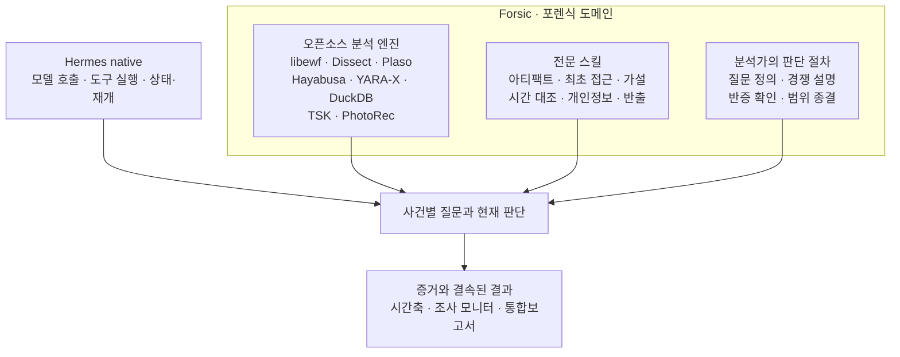
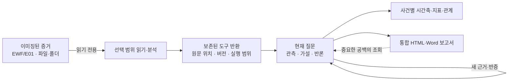
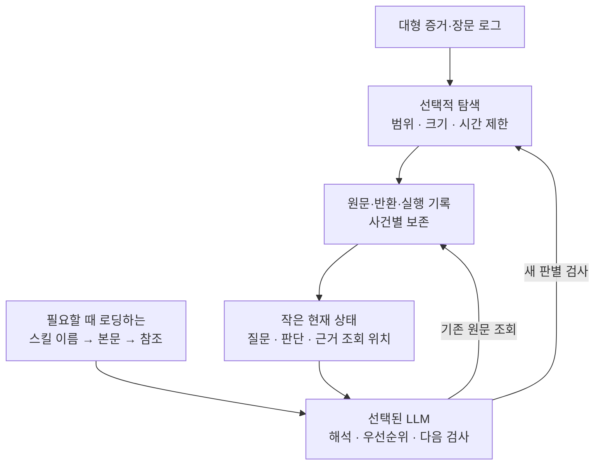

# Forsic의 설계와 차별점

[← README](../README.md)

Forsic은 범용 LLM 에이전트에 포렌식 명령어 몇 개를 추가한 구성이 아닙니다. **디스크 이미지로부터 사건의 답을 만들어 가는 과정**을 도구·스킬·사건 기록의 세 부분으로 나눈 포렌식 전용 하네스입니다.

## 왜 범용 하네스와 다른가

범용 에이전트 하네스는 대화, 도구 실행, 세션, 중단·재개 같은 실행 문제를 해결합니다. 포렌식에서는 그것만으로 충분하지 않습니다. 어떤 도구로 파일을 읽었는지뿐 아니라, **그 결과가 어느 원문에서 왔고 무엇을 입증하지는 못하는지**가 중요하기 때문입니다.

| 구분 | Hermes가 제공하는 범용 기반 | Forsic이 추가하는 포렌식 전용 책임 |
| --- | --- | --- |
| 실행 | 모델·도구 호출, 세션, goal, 중단·재개 | 사건과 증거 범위에 묶인 도구 실행 |
| 지식 | 필요에 따라 로딩하는 스킬 | 초기 접근·아티팩트·시간·유출 등 전문 조사 절차 |
| 상태 | 대화 및 작업 진행 상태 | 질문별 현재 판단, 근거, 반론, 정정·재검토 조건 |
| 입력 | 일반 도구 반환 | 읽기 전용 증거 접근, 원문 위치·반환 범위·버전 기록 |
| 결과 | 사용자에게 전달할 답변 | 사건 시간축, 관계·지표, 근거 연결된 통합보고서 |
| 한계 | 공통 도구·모델 능력에 의존 | 미지원 형식·미탐색 범위·추정과 사실의 구분을 조사 기록에 유지 |

이 표는 Hermes에 없는 기능을 전부 주장하는 비교가 아닙니다. **Forsic이 별도로 소유하고 책임지는 영역**을 보여줍니다. 두 번째 에이전트 루프, 별도 goal 스케줄러, 별도 압축 엔진을 만들어 대체하지 않는 것이 개발 원칙입니다.

## 세 가지 요소의 결합

**오픈소스 도구**는 원본에서 구조화된 정보를 추출합니다. **전문 스킬**은 어떤 증거가 현재 질문에 도움이 되는지 안내합니다. **분석가의 판단 절차**는 발견한 파일·명령·연결을 곧바로 공격 사실로 단정하지 않고, 대안 설명과 필요한 추가 검사를 고르게 합니다.

예를 들어, 예약 작업이 설정돼 있다는 사실만으로 실행됐다고 단정할 수 없습니다. 프로그램이 설치됐다는 것과 실행됐다는 것, 외부 연결을 시도했다는 것과 데이터를 실제로 반출했다는 것도 다릅니다. 이런 **주장 간의 경계**를 스킬과 사건 기록에 반영했습니다.

실무에서 사용하는 조사 접근법을 구현에 반영했다는 의미이며, 모든 사건에서 자동으로 정확한 결론을 낸다는 뜻은 아닙니다.

## 증거에서 결론으로

- **원본과 파생물을 구분:** Docker 분석 작업공간은 원본 증거를 읽기 전용으로 다루고, 추출물은 `/work`에 기록합니다. 일부 EWF 메타데이터·검증 유틸리티는 호스트에서 동작하므로 전체 분석이 단일 컨테이너에 갇힌 것은 아닙니다.
- **출처와 해석을 구분:** 원문 좌표·버전 검증은 프로그램이 맡고, 인용이 실제로 결론을 뒷받침하는지에 대한 해석은 조사 모델과 분석가의 검토 대상입니다.
- **미확인을 남김:** 읽지 않은 영역이나 지원되지 않는 파서는 무혐의·무침해 증거가 아닙니다. 시각이 없으면 사건 발생시각을 임의로 만들지 않습니다.
- **수정 가능한 현재 판단:** 새 반증이 나오면 같은 질문의 판단을 갱신하고 이전 판단은 이력으로 보존합니다.
- **보고 중 재조사:** 통합보고서에서 중요한 공백을 조회해 기존 조사로 돌아갈 수 있습니다. 조회만으로 권한을 확대하거나 멈춘 조사를 자동 재개하지 않습니다.

## 로컬 모델을 고려한 구조

포렌식 증거는 모델 문맥보다 훨씬 클 수 있습니다. Forsic은 디스크 이미지와 장문 로그를 모델 입력에 직접 쏟아붓는 방식 대신, **모델에 필요한 판단 단위만 전달**하도록 구성했습니다.

현재 구현의 구체적 선택은 다음과 같습니다.

1. **작은 상태 투영:** `investigation_context.py`는 상태 문맥을 바이트 예산 안에서 구성하고 생략을 명시합니다. 자세한 원문은 기존 조회 경로에서 다시 불러옵니다.
2. **턴 단위 문맥 경계:** `turn_context.py`는 전체 판단을 중간에서 잘라내기보다 선택적 블록을 통째로 제외하고 다시 조회할 위치를 남깁니다.
3. **단계적 스킬 공개:** 스킬 이름·용도부터 제공하고, 실제 조사에 필요한 본문이나 참고자료만 선택합니다.
4. **스트리밍·페이지 검색:** 일반 텍스트 및 이미지 내부 할당 파일의 검색을 구간별로 진행하고 `next_cursor` 등으로 이어 읽습니다. 일부 결과만 보고 전체 파일 검사 완료라고 주장하지 않습니다.
5. **실행 결과 재사용:** `report_research.py`는 같은 질문·범위·입력 조건의 기존 작업을 확인해 의미 없는 재실행을 줄이도록 합니다. 새 근거나 조건이 생기면 새 검사를 할 수 있습니다.
6. **제한된 분석 작업공간:** `forsic_shell`은 별도 분석 컨테이너에서 자원·권한·출력 크기를 제한합니다. 비용을 제한하는 장치이지 결과의 의미적 정확성을 보장하는 장치는 아닙니다.

이것은 **로컬 환경을 고려한 엔지니어링 설계**입니다. 특정 모델이 더 빠르거나 정확하다는 성능 수치, 모든 하드웨어와 파일시스템에서의 처리량을 입증하는 주장은 포함하지 않습니다.

## 보고서를 작성하는 방식

최신 구현은 `integrated.html`과 `integrated.docx`를 같은 사건 스냅샷에서 생성합니다. 본문은 일곱 가지 판단을 다루고, 같은 문서의 부록에 원문·실행 범위·시간 가정·반론과 정정을 넣습니다.

| 본문이 답할 내용 | 부록에서 검증할 내용 |
| --- | --- |
| 침해가 언제 시작됐는가 | 관측 시각·추정 근거·시계/로그 한계 |
| 최초 진입 경로는 무엇인가 | 인증·서비스·실행 흔적의 연계 |
| 어떤 행위가 있었는가 | 파일·명령·프로세스 및 실제 실행 확인 |
| 개인정보가 존재했는가 | 데이터 유형·대상·검토 범위 |
| 외부 노출·반출이 있었는가 | 접속과 성공·전송 내용의 구분 |
| 결론을 지지하는 핵심 증거는 무엇인가 | 원문 위치·검사 조건·반론 |
| 사건이 어떻게 전개됐는가 | 시간축의 출처와 추정 구간 |

보고서 작성 중 중요한 질문이 드러나면 기존 조사 조회와 도구로 재검토할 수 있습니다. 이 기능은 **재조사 연결 경로를 제공하는 것**이지, 보고서 출력만으로 조사 완결성이나 모델의 자율 판단 정확성이 검증됐다는 뜻은 아닙니다.

## 구현 근거 및 관련 문서

- [Hermes와 Forsic의 역할 경계](../AGENTS.md) · [전체 설계](../DESIGN.txt)
- [현재 문맥 투영](../forsic_plugin/investigation_context.py) · [턴 문맥 조립](../forsic_plugin/turn_context.py)
- [도구 반환 요약](../forsic_plugin/context_results.py) · [분석 작업공간](../forsic_plugin/shell_workspace.py)
- [보고 중 조회/재조사](../forsic_plugin/report_driven/report_research.py) · [보고서 일곱 축](../forsic_plugin/report_driven/report_slots.py)
- [통합보고 구현 계약](../REPORTING_V2.txt) · [도구 및 스킬 구성](TOOLS_AND_SKILLS.md)

**적용 범위:** 이 문서는 `main`의 [`107e283`](https://github.com/jhemj/forsic/commit/107e2836f871234f55e8f151092c82a4d9f6ea94) 기준 구현과 설계 문서를 설명합니다. 합성 시험의 통과와 실제 사건에서의 포렌식 결론 정확성은 구분해야 합니다.
