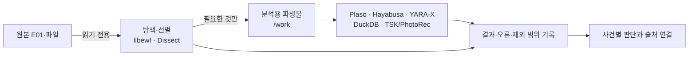

# 포렌식 도구와 조사 스킬

[← README](../README.md) · [설계와 차별점](ARCHITECTURE.md)

Forsic의 특징은 포렌식 프로그램을 많이 나열하는 데 있지 않습니다. **현재 조사 질문에 필요한 도구를 선택하고, 실제 반환값과 원문을 연결해 다음 판단에 사용하는 것**에 있습니다.

## 오픈소스 분석 도구

| 조사 대상 | 도구·기술 | 적용 범위와 주의할 점 |
| --- | --- | --- |
| EWF/E01 이미지 | `libewf`, `ewfinfo`, `ewfverify` | 이미지 정보와 검증; 검증 성공이 취득 전 무침해를 뜻하지는 않음 |
| 이미지 내부 파일 | `Dissect` | 지원되는 파일시스템의 할당 파일 탐색·읽기·검색; 삭제 파일 복구와 구별 |
| 파일시스템·복구 작업 | `Sleuth Kit`, `PhotoRec`, `ewfexport` | 실제 설치 형식·파일시스템 지원을 확인한 후 선택 범위의 파생 자료에 적용 |
| 사건 시간축 | `Plaso` (`log2timeline`, `psort`) | 필요한 파일·파서만 선택해 추출하고 원시 시각·변환 조건을 보존 |
| Windows 이벤트 | `Hayabusa` | 선택한 EVTX를 로컬 규칙으로 탐지 후보화; 원문 이벤트 재확인 필요 |
| 파일 패턴 | `YARA-X` | 검토한 규칙을 선택해 스캔; 규칙집 전체가 기본 제공되는 것은 아님 |
| 구조화 로그 | `DuckDB` | 선택 CSV/JSONL의 필터·집계·조인; 원본 파서 자체를 대신하지 않음 |
| 문서·스크립트 | 선택적 파서와 검사 절차 | 형식 지원·출력 범위를 확인하며, 증거 속 코드를 실행하지 않음 |

도구의 설치와 버전 고정은 [ANALYSIS_TOOLS.txt](../ANALYSIS_TOOLS.txt)와 [DEPLOYMENT.txt](../DEPLOYMENT.txt)를 따릅니다. 일부 분석 엔진은 **별도 분석 이미지 빌드가 완료된 환경에서만** 사용할 수 있습니다. 도구가 설치돼 있다는 것과 해당 이미지·파일 형식을 성공적으로 분석했다는 것은 다른 사실입니다.

*도구 실행 순서를 고정한 파이프라인이 아닙니다. 질문과 증거 종류에 맞는 경로만 선택합니다.*

## 조사 스킬

스킬은 도구의 별도 실행기가 아니라 **조사 질문과 증거 해석을 돕는 절차**입니다. 기본적으로 이름과 용도를 알리고 필요한 본문과 참고자료만 로딩합니다.

| 질문·업무 | 대표 스킬 | 무엇을 구분하는가 |
| --- | --- | --- |
| 종합 조사 설계 | `forensic-investigation` | 질문 범위, 우선순위, 유력 설명과 재검토 조건 |
| 최초 접근 | `initial-access` | 접속 시도·인증 성공·세션·행위자 |
| 증거 위치·파일 탐색 | `source-triage`, `evidence-intake` | 자료의 존재·읽힌 범위·실제 분석 완료 |
| 운영체제 아티팩트 | `inspect-artifacts`, `investigation-recipes` | 설치·설정·실행, cron·Run 키 등 구체적인 차이 |
| 스크립트·문서 | `inspect-scripts`, `inspect-documents` | 정적 내용과 실제 실행·효과의 구분 |
| 규칙·로그 분석 | `scan-windows-events`, `scan-file-rules`, `query-structured-logs` | 규칙 탐지·쿼리 결과와 확정 사실의 구분 |
| 시간축 | `correlate-time`, `import-timeline` | 원문 시각·파일 메타데이터·추정 시각 |
| 개인정보·유출 | `personal-data-scope`, `data-movement` | 보유·접근·전송 시도·전송 성공·내용 확인 |
| 판단 검토 | `test-hypothesis`, `review-conclusions` | 유력한 설명·경쟁 가설·반증 |
| 보고서 | `forsic-report-driven`, `executive-followup` | 일곱 판단 축·독자 질문·기존 조사로 환류 |
| 지표·과거 사례 | `organize-indicators`, `consult-previous-cases`, `threat-intelligence` | 관측 지표와 악성 판정, 사례 유사성과 직접 증거의 구분 |

스킬 정의는 [`forsic_plugin/skills/`](../forsic_plugin/skills/)에 있습니다. 조사 절차는 각 사건의 실제 자료·사용 권한·지원 형식에 따라 달라집니다.

## 도구·스킬 사용 설정

조사 모니터의 **도구 / 스킬** 탭에서 항목별 사용 여부와 **대상 증거 OS**를
선택합니다. 설치 컴퓨터의 운영체제가 아니라 조사할 자료의 Windows·macOS·Linux를
선택하며, 혼합 자료에는 **전체 / 혼합**을 사용합니다.

- 설정은 현재 프로필의 모든 사건·대화에 적용됩니다. 설치 컴퓨터의 로컬 관리 화면에서 변경하며, 조사 실행·압축이 멈춘 상태에서 저장합니다.
- OS 선택은 기본 구성을 정합니다. 현재 공통 도구·절차는 유지하고 Windows 전용 이벤트 스캔 스킬만 해당 OS에 맞춰 기본 노출합니다. 개별 선택으로 혼합 자료에 필요한 항목을 켤 수 있습니다.
- OS를 다시 선택하면 도구·스킬의 개별 변경을 기본 구성으로 되돌립니다. 화면의 변경은 **저장**해야 반영됩니다.
- 원문 조회, 현재 질문과 렌 답변 저장, 근거·보고서 저장 등 핵심 도구는 항상 켜져 있습니다. 선택 도구와 스킬을 꺼도 기존 기록은 삭제하지 않습니다.
- 포식이는 허용된 도구와 스킬 중 필요한 것을 선택합니다. 사용자가 끈 항목을 모델이 다시 켜는 도구는 제공하지 않습니다.
- 저장 후 실제 도구 목록과 세션에 보존된 구성을 대조합니다. 반영이 확인되지 않으면 대기 상태와 다시 적용할 수 있는 버튼을 표시합니다. 재접속·서버 재시작 후에도 저장 설정을 따릅니다.

이 설정은 Forsic 도구와 스킬의 노출·호출을 제어합니다. 켜진 분석 터미널 안의
개별 명령을 차단하는 기능은 아닙니다. 네트워크·원본 쓰기·외부 전송 권한은 기존
격리와 승인 경계를 따릅니다.

## 현장에서 중요한 구분

- **설정 ≠ 실행:** 예약 작업, Run 키, 서비스 파일이 있다는 사실만으로 해당 명령이 실행된 것은 아닙니다.
- **통신 ≠ 유출:** DNS 조회나 연결 기록만으로 자료 전송이나 개인정보 반출을 확정할 수 없습니다.
- **기록 없음 ≠ 행위 없음:** 수집 범위, 로그 생성·보존·회전, 검색 누락을 고려합니다.
- **해시 일치 ≠ 무침해:** 채증 자료의 무결성 검증과 과거 행위의 판단은 별개입니다.
- **도구 성공 ≠ 조사 완료:** 반환 범위·건너뛴 파일·오류·미지원 항목을 함께 남깁니다.

이 구분들이 전문 스킬과 사건 원장에 반영되어 있습니다. 이 원칙을 적용한 조사 결과도 최종적으로는 근거와 함께 검토해야 합니다.

## 실행 및 보안 범위

- 기본 분석 공간은 Docker의 `/evidence`(읽기 전용)와 `/work`(파생물 저장)를 구분합니다. 네트워크는 차단되고 자원 한도가 적용됩니다.
- EWF 메타데이터·무결성 검사 등 일부 작업은 호스트 유틸리티로 수행됩니다. 모든 분석 도구를 하나의 격리 경계에 있다고 표현하지 않습니다.
- 대용량 복구·카빙, 모든 파일시스템, 전체 메모리 분석을 포괄하는 제품이라고 주장하지 않습니다. 특히 XFS 삭제 파일을 일반적인 TSK 성공 사례로 설명할 수 없습니다.
- 오픈소스 도구와 규칙은 각기 다른 라이선스와 갱신 주기를 갖습니다. 실제 고정 버전·해시·설치 조건은 [lock 파일](../tools/forensic-tools.lock.json)과 [제3자 고지](../THIRD_PARTY_NOTICES.txt)를 확인하세요.
